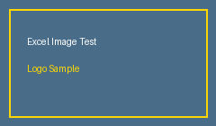

# 图片测试

<!-- 由 excel-to-md Skill 生成；源 Excel 未被修改。 -->

> 来源文件：`图片测试.xlsx`；工作表：1 个

> 公式保留表达式及缓存结果；无法直接转换的对象见 conversion-report.json。

# 工作表：图片测试

> 原序号：1；状态：可见；范围：A1:A14；合并单元格：0 个

Excel 图片转换测试

下面有一张图片：

位置：A4~D10，6.35×3.70cm

图片结束

Markdown 中图片应该显示为 !\[\](image.png)
